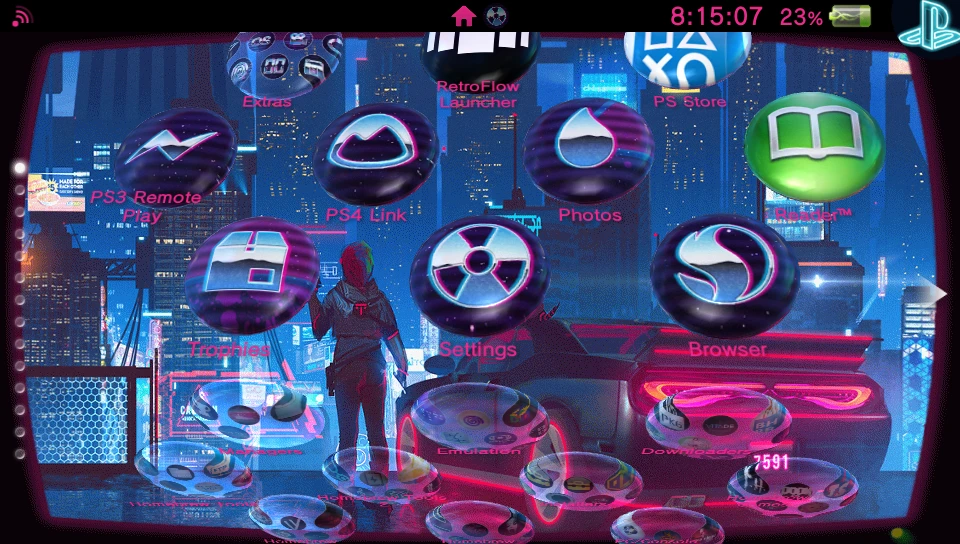
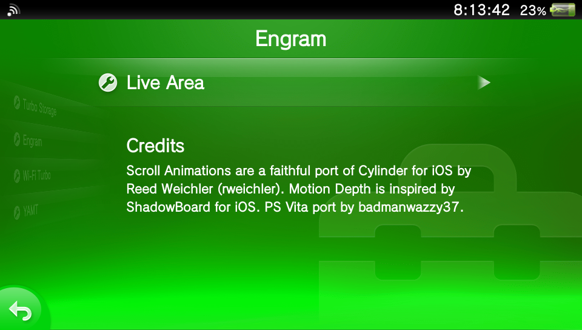
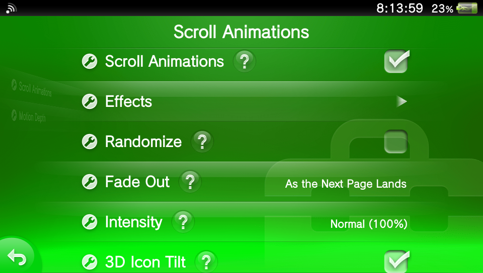
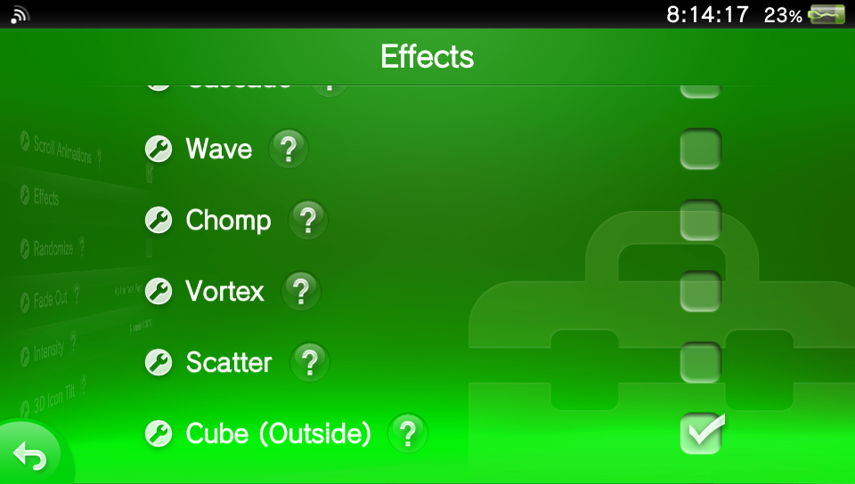
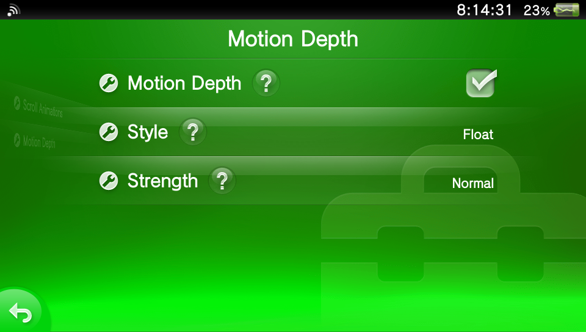

# Engram



Engram is a set of tweaks for the PS Vita's home screen, set in **Settings → System → Engram**. Its settings are grouped by category. There are two, **Live Area** and **Fonts**.

**Live Area** has four tweaks:

- **Scroll Animations**, a faithful port of [Cylinder](https://github.com/rweichler/cylinder) for iOS. The icons move as you scroll between pages. Effects can be combined, or picked at random for each scroll.
- **Motion Depth**, inspired by ShadowBoard for iOS. Tilt the Vita and the icons float above the wallpaper in 3D.
- **Icon Placement**, 3D layouts for the icons in place of the Vita's grid: an open book, a sphere like the Apple Watch's app grid, or the inside of a sphere.
- **App Page Animation**, the scroll animations for the apps' LiveArea pages, as you swipe left and right between them.

**Fonts** changes the system's font with fonts of your own: one for the whole Live Area, separate ones for the lock screen, the status bar and notifications, the boot warning and the quick menu if you like, and one for each of 17 system apps.

Engram will grow with future updates: more ways to change the home screen's animations, lock screen customizations, and more. New categories will sit next to Live Area and Fonts.

| | |
|---|---|
|  |  |
|  |  |

```text
Settings > System > Engram
  Engram                switch: on unless the failsafe (or you) turned Engram off
  Live Area
    Scroll Animations   switch, Effects, Randomize, Fade Out, Intensity, 3D Icon Tilt
    Motion Depth        switch, Style, Strength
    Icon Placement      Layout, Strength, Folders, Folder Layout, Folder Strength
    App Page Animation  switch, Effect, Fade Out, Fade In, Intensity
  Fonts
    Live Area, Lock Screen, Status Bar & Notifications, Boot Warning, Quick Menu
    Apps                a font for each of 17 system apps
    About Fonts
  Credits
```

## What's new in 1.5

1.5 is the second public release, after 1.0. Everything since 1.0:

**New**

- **Icon Placement** (Live Area): Open Book, Sphere and Inverted Sphere layouts for the home screen's icons, and for the icons in an open folder.
- **App Page Animation** (Live Area): the scroll animations for the apps' LiveArea pages as you swipe between them: Cube (Inside), Spin, Shrink or Random, with Fade Out, Fade In and Intensity.
- **Fonts**, a new category: your own fonts for the Live Area, the lock screen, the status bar and notifications, the boot warning, the quick menu, and 17 system apps. See [Fonts](#fonts).
- **The Engram switch**, at the top of the Engram page. It shows whether Engram is running, and turns it back on after the failsafe has turned it off. See [Safety and diagnostics](#safety-and-diagnostics).

**Improved**

- **Engram rests while an app is open.** With an app in front, Motion Depth stops reading the motion sensor and nothing else runs until you're back on the home screen, which saves battery.
- **Edit mode pauses the effects.** Holding an empty spot on the home screen to rearrange icons pauses Scroll Animations and Icon Placement until you're done.
- **The failsafe is less jumpy.** It now turns Engram off only after two boots in a row that crashed within 30 seconds, so a quick restart (to apply a font, say) no longer turns Engram off.
- **The log starts again** once it passes 256 KB, and the previous one is kept as `log.old.txt`, so a log you send is recent.

**Fixes**

Some of these may fix problems people saw on 1.0:

- **Motion Depth didn't respond to the Vita turning** on Vitas where nothing else had started the motion sensor, because the sensor's deadband swallowed slow turns. Engram now turns the deadband off while it reads the sensor, so Motion Depth works with or without reVitaMotion ([#1](https://github.com/chazzarchibald-ops/engram-vita/issues/1)).
- **Icons ended up tilted at the wrong angles** after opening and closing folders with Icon Placement and scroll effects on. Engram now works from where SceShell has each icon at the time, not where it was earlier.
- **Other plugins' Settings entries could disappear** next to Engram's (Turbo Storage's, for one). Engram now adds its rows after theirs when its line comes straight after `henkaku.suprx` (see [Install](#install)), and adds a smaller page otherwise, so Turbo Storage's still fits.
- **Long descriptions in Settings were cut off** after 255 characters.
- **Possibly fixed:** the Settings app not responding to touch after using App Page Animation, which may have been an app page left almost invisible in front. If you still see it, please open an issue.
- **A Troubleshooting section** for when Engram's page doesn't show up in Settings ([#2](https://github.com/chazzarchibald-ops/engram-vita/issues/2)).

**Shelved**

- A second try at Wallpaper Parallax didn't work out, and is shelved with Shadows (see below).

## Credits

- **Engram** by badmanwazzy37.
- **Cylinder** for iOS: Reed Weichler ([rweichler](https://github.com/rweichler/cylinder)).
- **ShadowBoard** for iOS, the idea behind Motion Depth.
- The Settings page follows the recipe of HENkaku's settings and [Turbo Storage](https://github.com/juanjsebgarcia/vita-turbo-storage) (MIT).

The same credits appear at the bottom of the Engram page in Settings, as the small description text of a Credits row.

Retail firmware 3.65 only, because it checks SceShell's module NID.

## Scroll Animations

The Vita's home screen scrolls vertically, so each effect is Cylinder's idea turned 90 degrees.

| Effect | What it does |
|---|---|
| Stay Put | Icons hold still and fade out while the page slides away |
| Stairs | Columns leave one after another, left to right |
| Cascade | Icons leave one by one in reading order |
| Wave | A ripple runs across the rows as the page moves |
| Chomp | The page splits down the middle and the halves slide apart |
| Vortex | Icons swirl into the middle of the screen and vanish |
| Scatter | Icons fly apart in every direction and fade |
| Cube (Outside) | Pages are the faces of a turning cube, seen from outside. On by default |
| Cube (Inside) | Pages are the walls of a turning cube, seen from inside |
| Hinge | The page swings away on its top or bottom edge |
| Card Flip | The page flips over like a card to show the next one |
| Blinds | Each icon flips in place like a slat of a blind |
| Spin | Every icon turns one full circle per page |
| Shrink | Icons shrink to nothing as their page leaves |
| Page Fade | The page fades out as it leaves and in as it arrives |

When several are on, they're applied in the order above. For example, Spin and Shrink together give a spinning shrink, and Cube (Outside) with Page Fade gives a fading cube.

| Setting | Default | |
|---|---|---|
| Scroll Animations | On | This tweak's switch (called Icon Animations before 1.1) |
| Effects | Cube (Outside) | One toggle per effect |
| Randomize | Off | Each scroll uses one of the effects you've turned on, picked at random |
| Intensity | Normal (100%) | 50% to 150%: how far the effects move, turn and fade the icons |
| 3D Icon Tilt | On | The 3D effects turn the icons themselves. Turn it off to flatten them instead, if tilted icons look wrong |
| Fade Out | During the Swipe | When the page you swipe away from fades out. **During the Swipe**: gone by 60% of the way. **As the Next Page Lands**: fully visible until 60% of the way, then gone as the next page settles. **Off**: no fade. The incoming page always stays fully visible, and it works with no effects turned on too |

## Motion Depth

The icons act as a layer floating above the wallpaper. Turn the Vita and they respond to the turn. Hold it still at any angle and they drift back to the middle over a second or two, the way iOS's parallax does.

| Setting | Default | |
|---|---|---|
| Motion Depth | On | This tweak's switch |
| Style | Float and Turn | **Float**: the icons drift against the wallpaper, towards the edge you tilt away. **Turn to Face You**: each icon turns back against the Vita's turn, so it keeps facing you. **Float and Turn**: both |
| Strength | Normal | Subtle, Normal, Strong or Extreme. At Normal the icons float up to about 40 px and turn up to about 25° |

It works with Scroll Animations, including mid-scroll. When the Vita stops turning and the icons are back in the middle, Engram puts every bubble back exactly as SceShell had it.

It reads the gyroscope through `sceMotionGetState`. SceShell already loads SceMotion, and Paf imports it. If sampling isn't running, Engram starts it, and stops it again when Motion Depth goes off.

### Shelved: Shadows and Wallpaper Parallax (1.7)

Neither worked on the console in 1.2 to 1.6, so 1.7 turns both off with `ENGRAM_SHADOWS_SHELVED` in `engram.h` and leaves them out of Settings. A second try at Wallpaper Parallax in the 1.1 test builds (moving one of three widgets that might carry the wallpaper, chosen with a Wallpaper Layer setting, and moving the icons back inside it) was shelved too, with `ENGRAM_PARALLAX_SHELVED`. The code is all still there; set the flag to 0 to bring them back. Their old config keys (`shadows`, `wallpaper`, `shadow_layer`, `shadow_depth`) are still read and written, and do nothing while shelved.

What was learned:

- **Shadows were always drawn over the icons.** The public `Widget::SetBehind` only queues a reorder. `SetBehind_core` reorders straight away and did put the shadow layer before the bubble container (1.4's log: layer child 1, container child 2), but the shadows still showed on top. Paf's draw objects have a depth test (`graph::DrawStyle::depth`), and in Cube (Outside) icons hide behind each other mid-turn, so depth is clearly in play. 1.5 pushed the shadows 16 px back in z, and 1.6 offered six orders and z offsets (Settings > Shadow Layering, A to F). None of them put the shadows behind, going by the user's report; no 1.6 log was fetched. Next to try: read the shadow plane's and a bubble's `DrawStyle` (blend and depth) through `GetDrawObj`, or make the shadows draw objects of the bubble itself.
- **The wallpaper never moved.** The plane `0xF1B811BF` inside each page exists but is hidden with a custom photo theme. 1.4's log showed a widget beside the pages' scroller (`37677DEF`, 13 children for 13 pages, drawn before them), which 1.5 and 1.6 moved, but nothing moved on screen. 1.6's log ruled it out: its first child (`C69A0237`, 960×512, 3 children) is hidden, and its second is a 138×138 widget, not a page-sized one, so it isn't one photo per page. The photo wallpaper's widget is still to be found; it may not be a widget at all, like the default wave. 1.6's log also confirms each arrangement put the layer where intended (A, B and E before the container; C, D and F after it), so it's the depth test and not the order that keeps the shadows on top.

| Setting (shelved) | Default | |
|---|---|---|
| Shadows | On | A round shadow with a crisp edge under each icon, about the icon's size, as in ShadowBoard. It stays down on the wallpaper, 10 px below the icon as if lit from above, and slides with the wallpaper when there's one that moves. So tilting opens a gap between an icon and its shadow, and the icons look like they hover. Works with Motion Depth off too, as still shadows |
| Wallpaper Parallax | On | The wallpaper zooms in 10% and slides the other way as you tilt, half as far as the icons float, as on iOS. This works with a custom theme's wallpaper. 1.3 and 1.4 looked for it in the plane `0xF1B811BF` in each page, which is there but hidden. 1.4's log showed a widget beside the pages' scroller, drawn before them, with one child per page (`37677DEF` on the test console), so 1.5 moves the page's child of that, found by walking up from the page. The Vita's own wave background isn't a widget, because Paf's graphics code draws it (see psp2wpp), so it stays still |

ShadowBoard itself draws a drop shadow behind each icon that moves as you tilt (by the accelerometer, with no settings).

How the shadows are made (1.2):

- **The texture** is a 64×64 circle that Engram draws itself, solid out to 88% of its radius and then fading over the rest, built once with `graph::Surface`'s constructor and `Copy`, and never freed. Vita icons are square images that SceShell shows as circles, so a tinted copy of the icon would have made square shadows. Every byte of a pixel is the same, so the planes are tinted black with `SetColor(0, 0, 0, a)` whatever byte order the format uses.
- **The widgets:** each page on screen gets one layer of Engram's own, a size-0 `plane` made with `Plugin::CreateWidget` from topmenu_plugin's plain `style_plane` (`0x03C69492`). It sits beside the bubble container, not in it, in case SceShell counts the container's children, and just before it in the child list, because Paf draws children in order. Each bubble gets one 132×132 plane in that layer.
- **The draw order:** the public `Widget::SetBehind` doesn't move anything itself. Paf's code shows it posting `{parent, widget, target}` to a request list and returning 0, which is why 1.2 and 1.3 saw the order unchanged and the shadows on top. 1.4 calls `SetBehind_core` (NID `0xD6FB21CB`), which does the move there and then through the parent's `ReorderChild`, and checks the order every frame. That worked (the layer became child 1, the container child 2), but the shadows still showed on top: Paf's draw objects have a depth test (`graph::DrawStyle::depth`), and drawn first at the icons' own z, the shadows made the icons fail it. 1.5 also puts the shadows `shadow_depth` px further back (16 by default). That's a config key with no Settings entry, and it's reread every second, so it can be tuned live in `ur0:data/engram/config.txt`.
- **No stored pointers:** each frame Engram finds the layers and shadows again by their own made-up ids (`0x45475348`, `0x45475353`), under the pages on screen. When SceShell frees a page, its shadows go with it.
- Shadows fade out as soon as a page starts to scroll, and stay hidden while SceShell is animating a bubble (`FindAnim`) and for 1.5 s after the home page appears.
- `IDParam` is filled in by hand: its constructor would import Paf's shared empty string, a variable that a plugin loading before Paf can't rely on.

## Icon Placement

Where the icons rest. Scroll Animations and Motion Depth work on top of it, starting from where it puts each icon.

| Setting | Default | What it does |
|---|---|---|
| Layout | Off (Vita Grid) | **Open Book:** two pages either side of a spine down the middle, angled like a book held open in front of you. The spine is furthest away, so the icons beside it are smaller, and every icon is turned to lie on its page. Each page holds 5 icons, laid out like the five on a die: two on top, one in the middle, two on the bottom. They fill in reading order: the left page's 5, then the right page's, so a full Vita page of 10 fills both. **Sphere:** the page is the near side of a big ball, seen close up, like the Apple Watch's app grid. The layout stays the Vita's, but the icons in the middle are bigger and the ones further out are smaller and turned to lie on the ball. It's spread out sideways to be as wide as the inverted sphere, most at the edges. **Inverted Sphere:** the inside of the ball. The middle is furthest away, and the icons get bigger towards the edges |
| Strength | Normal | Subtle, Normal, Strong or Extreme: how far the book's pages are angled (17° to 46°), or how round the ball is |
| Folders | Off | Lay out the icons in an open folder too, with a layout of their own |
| Folder Layout | Sphere | Open Book, Sphere or Inverted Sphere, for open folders |
| Folder Strength | Normal | The same as Strength, for open folders |

How it works:

- **The layout is worked out from the grid every frame.** SceShell keeps each bubble in its grid slot, and Engram moves, scales and turns it to where the layout puts that slot, much as Scroll Animations does mid-scroll. So the layout follows SceShell: new bubbles, recreated ones and rearranged pages all land in it.
- **A page goes back to the grid while SceShell is working on it.** If SceShell is moving, scaling or turning any bubble on the page (`FindAnim`, as when a folder opens or closes or the icons come in), or one is off the grid (being dragged in edit mode), the page goes back to the grid, leaving SceShell's animations alone. When it's settled, the page eases back into the layout over a quarter of a second.
- **Folders:** opening a folder makes a new widget on the home page, outside the pages' scroller, with a new id each time, and the folder's icons are in an icon container (`0xC6063E76`) inside it, named "0", "1" and so on like the home screen's. Each frame Engram looks for visible icon containers outside the scroller, and only places their icons once they're all on a known grid: the home grid, or the 124 px 3-4-3 grid the probe found beside the pages. The first few containers and open folders it finds are logged (`folder: ...`).
- **Edit mode** (hold an empty spot on the home screen) pauses Icon Placement and Scroll Animations, and they come back once you're out of it. In edit mode SceShell zooms the pages out and adds a few buttons; the icons don't wobble. The log showed it as a new widget beside the pages' scroller, with a new id each time and no icons in it, so that's what Engram looks for. An open folder is a new widget there too, but it holds the folder's icons.
- **Folder icons are made afresh each time a folder opens,** and they take on the turn and scale of the folder's icon on the home screen, which the home layout may have turned. So when the folder layout is off, each icon of an open folder is set upright at full size once, after the folder has finished opening.
- **Changing the layout** eases the old one out, then the new one in. A page coming onto the screen is already in the layout.
- **Not checked yet on the console:** whether tapping an icon follows it to its new place, and which way Paf turns icons (if the book's pages bulge towards you instead of away, the turn's sign is the wrong way round).

## App Page Animation

Tap an icon and its app's LiveArea page opens; swipe left and right to go between the home screen and the pages of the apps you've opened. App Page Animation plays the scroll animations as you do.

| Setting | Default | What it does |
|---|---|---|
| App Page Animation | On | This tweak's switch |
| Effect | Cube (Inside) | One at a time: Cube (Inside), Spin, Shrink, or Random (a different one each swipe). Each page moves as one card, so Stairs, Cascade and Chomp aren't offered, and nor are Stay Put (holding two whole pages still in the middle of the screen covered one with the other), or Vortex, Scatter, Card Flip, Blinds, Hinge, Cube (Outside), Wave and Page Fade (all glitchy on whole pages in testing) |
| Fade Out | Off | When the page you swipe away from fades out: during the swipe, or as the next page lands. An app page's background you can peel off doesn't fade (it ignores every alpha Paf has) |
| Fade In | Off | When the page you swipe to fades in, the home screen as well as an app's page: during the swipe (fully in by 60% of the way), or as it lands |
| Intensity | Normal (100%) | How far the effect moves, turns and fades the pages |

How it works:

- **The home screen and the app pages are one strip.** In `page_top`, `0x9CC405A3` holds it as its first child, and the strip's children are the screens, 960 px apart: the home screen (`0x8FCDE1B9`, 960 wide) at x = 0, then one app page (840 wide; the rest is room for the arrows) per app you've opened. Swiping slides the strip: at x = -960 the first app page is in front. A probe build found this by watching for widgets whose children sit a screen apart sideways.
- **Each page is animated as a whole**, so its background and everything on it go with it. Fading uses the page's meta alpha (`Widget::SetMetaAlpha`), which unlike its colour reaches what's on it; the background you can peel off (the first child of `0xB34A295B`, a 3D `paf::ui::PageTurn`) ignores every alpha, so it doesn't fade.
- **Tried and dropped** (each made the swipes look worse on the console): moving only what's inside each page, easing the effect in and out over time, landing the page early, a farther eye, and turning pages out instead of fading them. Moving the pages themselves does nudge where SceShell stops the strip, since it reads their positions, but the swipes looked smoothest this way.
- **The effects are the scroll ones, turned on their side:** run with the page's length along the swipe (960) and across it (512), then the axes are swapped, so a turn about the horizontal axis becomes one about the vertical.
- Each page goes back exactly as it was when the strip settles. A page SceShell is animating (opening, or peeling off) is left to it.

## Fonts

Put your fonts in `ur0:data/engram/fonts` (`.ttf`, `.otf` or `.pvf`, up to 40). Every list in Fonts shows the fonts it finds there, by file name.

| Setting | Default | What it changes |
|---|---|---|
| Live Area | System Font | The whole home screen's font: the Live Area and its app pages, and everything below that's left on Same as Live Area |
| Lock Screen | Same as Live Area | The lock screen's clock and date |
| Status Bar & Notifications | Same as Live Area | The status bar at the top of the screen (the clock and the battery) and the notifications |
| Boot Warning | Same as Live Area | The warning the Vita shows as it starts, before the lock screen. It works with VitaTweaks' CustomWarning text too |
| Quick Menu | Same as Live Area | The quick menu you open by holding the PS button, its buttons and toggles included (and Quick Menu Plus's Restart and Power Off) |
| Apps | Same as Live Area | A font for each of 17 system apps: Settings, Music, Videos, Photos, Internet Browser, PlayStation Store, Trophy Collection, Friends, Messages, Party, near, Content Manager, Email, Calendar, PS4 Link, PS3 Remote Play and Parental Controls. Each can be Same as Live Area, System Font, or one of yours |

- **Restart the Vita** after changing the Live Area font or a place's. An app's font applies the next time the app opens.
- **Use a font with your language's letters**, or a multi-language one if you use more than one (English and Japanese, say). In a place's font, letters it doesn't have come from the Live Area font. In the Live Area font, they show as blanks or boxes.
- **1 MB limit on the home screen.** The home screen has little memory to spare (a 3.4 MB font crashed it in testing), so the Live Area and place lists mark fonts over 1 MB "(too big)", and Engram leaves them out there. Apps have far more memory and take bigger fonts.
- **Apps need Engram loaded in them:** add its line under each app's title ID in `config.txt` (see [Install](#install)). Panoramic Camera isn't offered: it wouldn't open with Engram loaded.
- **Games aren't touched.** Engram never loads into games, and their text is their own.

How it works:

- **The Live Area and the apps:** Paf, the UI library the home screen and system apps are built on, can open a font from memory for each of its four language slots (Japanese, Latin, Hangul and Chinese), given in `paf::Framework::InitParam`. Engram reads your font into its own memory and puts it in those slots as the app starts Paf, through the app's own import of the Framework constructor, so Paf opens it itself. Nothing shared between apps is patched: in a test build, hooking ScePaf's own imports on the home screen reached every app that uses Paf and crashed Settings.
- **The places:** Paf draws a character from its text's font family first, when that family has a font and the font has the character, and falls back to the language slots otherwise. Engram moves each place's text (text widgets, and the text objects of buttons and toggles) to a family nothing else uses, and puts the place's font into that family's font object in Paf's font cache, then has the text laid out again. It's all in the home screen's own memory. Paf loads at a different address each boot, so Engram reads the addresses it needs from Paf's own code, after checking that Paf is the 3.65 build it was written for.
- **The boot warning** is shown before the home screen is fully up, so Engram starts its place font check the moment Paf starts, and the warning comes up in its font from the start.

## Settings file

Settings are saved to `ur0:data/engram/config.txt`, and the home screen picks up changes within a second, with no restart needed.

## Install

1. Copy `engram.suprx` to `ur0:tai/engram.suprx`.
2. Add it to `ur0:tai/config.txt` in **two** places:
   ```text
   *main
   ur0:tai/engram.suprx

   *NPXS10015
   ur0:tai/henkaku.suprx
   ur0:tai/engram.suprx
   ```
   `*main` is the home screen. `*NPXS10015` is the Settings app, and that line adds the settings page. If you have other Settings plugins there, such as Turbo Storage, put Engram's line **straight after `henkaku.suprx`**. Then Engram adds its rows after Turbo Storage's, and both fit. Listed after Turbo Storage, Engram leaves out Fonts > Apps instead, and its page says why.
3. Optional, for **Fonts > Apps**: add the line under each system app you want a font for. Some apps run under two title IDs, so list both:
   ```text
   *NPXS10009
   ur0:tai/engram.suprx
   ```
   | App | Title IDs |
   |---|---|
   | Music | NPXS10009 |
   | Videos | NPXS10010, NPXS10085 |
   | Photos | NPXS10004 |
   | Internet Browser | NPXS10003, NPXS10090 |
   | PlayStation Store | NPXS10002 |
   | Trophy Collection | NPXS10008 |
   | Friends | NPXS10006 |
   | Messages | NPXS10014 |
   | Party | NPXS10001 |
   | near | NPXS10000 |
   | Content Manager | NPXS10026 |
   | Email | NPXS10072 |
   | Calendar | NPXS10091 |
   | PS4 Link | NPXS10013, NPXS10098 |
   | PS3 Remote Play | NPXS10012 |
   | Parental Controls | NPXS10094 |

   Settings (NPXS10015) already has the line. Don't add it under Panoramic Camera (NPXS10095): it won't open with Engram loaded.
4. For Fonts, put your fonts in `ur0:data/engram/fonts`. Engram makes the folder the first time it runs.
5. Reboot.

If `shelltheme` is also in `*main`, its page covers the native home screen, so you won't see Engram. Test Engram with shelltheme off: create `ur0:data/shelltheme/disabled`, or remove its line.

### Troubleshooting

- **No Engram in Settings → System, but the home screen effects work:** the `*NPXS10015` line is missing. Engram only adds its Settings entry when it's loaded into the Settings app itself.
- **Nothing works at all:** taiHEN reads `ux0:tai/config.txt` instead of `ur0:tai/config.txt` if the ux0 one exists. Add the lines to whichever one your Vita uses.
- **Engram worked, then stopped after a crash:** the failsafe turned it off. Change the setting you think caused it, turn the **Engram** switch at the top of the page back on, then reboot. Please send the log (see [Safety and diagnostics](#safety-and-diagnostics)).
- **Another plugin's Settings entry disappeared** (Turbo Storage's, say): put Engram's line straight after `henkaku.suprx` under `*NPXS10015`, as in [Install](#install).
- **A font shows blanks or boxes:** it doesn't have your language's letters. Use one that does, or a multi-language font.
- **A font is marked "(too big)":** it's over 1 MB, more than the home screen can take. Use a smaller font for the Live Area and the places. It still works for apps.
- **An app's font doesn't change:** check that the app's title ID has Engram's line in `config.txt`, then close and reopen the app.
- **Anything else:** open an issue with your firmware version, your `config.txt`, and `ur0:data/engram/log.txt` attached.

## Safety and diagnostics

- **The Engram switch** is at the top of the Engram page. It's on while Engram is running normally.
- **The failsafe:** from each boot until Engram has run for 30 seconds, `ur0:data/engram/booting` counts the boots that didn't get that far. After two in a row, the next boot writes `ur0:data/engram/disabled`, Engram stays off, and the Engram switch shows Off. While it's off, Engram changes nothing: not the home screen, not Settings' font, not the apps'. Its Settings page still opens, so you can turn it back on.
- **Turning it back on:** change the setting you think caused the crash, turn the Engram switch on (that deletes `disabled`), then restart. Turning on Scroll Animations, Motion Depth, App Page Animation or an Icon Placement layout also deletes it. You can turn the switch off yourself, too, to stop all of Engram from the next restart.
- **Please send the log** if the switch turned off by itself after a crash: open an issue at [github.com/chazzarchibald-ops/engram-vita/issues](https://github.com/chazzarchibald-ops/engram-vita/issues) with `ur0:data/engram/log.txt` attached, and `log.old.txt` too if it's there. The log notes each start of Engram in the home screen, Settings and apps, which fonts it loaded and how much memory was free, each place's text it moved to its font, and what it found if anything didn't match. The Engram switch's info text in Settings says the same.
- **Hold L at boot** to skip Engram for that boot. On Ensō this skips the home screen's other plugins too, shelltheme included.
- **With an app in front, Engram rests.** SceShell hides the home page then, and Engram stops sampling the motion sensor (if it was the one that started it) and does nothing else until the home page shows again. Engram loads into the home screen, the Settings app, and the system apps you list for Fonts > Apps, never into games.
- With the pages and the Vita both still and Icon Placement off, Engram changes nothing. It only touches bubbles on pages that are mid-scroll, remembers how each one looked first, and puts every one back exactly when its page settles. If SceShell moves a bubble itself mid-scroll (folders, recreated bubbles), Engram takes SceShell's value as the new resting state instead of fighting it.
- Every Settings hook is an import hook that passes through anything that isn't Engram's. If something doesn't match, the page simply doesn't appear.

Log: `ur0:data/engram/log.txt`.

## How it works

The probe found that the home screen (`page_top` in `topmenu_plugin`) has a scroll box (`0x0E61B084`). Its first child is a plane that moves as you scroll, and the pages hang off that plane 512 px apart. So each frame, a page's offset from the screen is `plane.y + page.y`, and its progress is that offset divided by 512. Engram registers a `MainThreadCallList` callback, which Paf runs every frame on its main thread. The callback works out each page's progress, then sets position, scale, rotation and alpha on that page's 138×138 bubbles in container `0xC6063E76`.

The 3D effects (cubes, hinge, card) turn the page about a horizontal axis, then project it with a perspective of 1000 px. Each icon's position and scale come from that projection, and with tilt on, the icon is also rotated about X.

The Settings page uses the same recipe as HENkaku and Turbo Storage ([vita-turbo-storage](https://github.com/juanjsebgarcia/vita-turbo-storage), MIT). It hooks SceSettings' `sceKernelLoadStartModule` and waits for `system_settings_core`. Then it splices a `setting_list` into the System page's XML, backs the rows with a private `/CONFIG/ENGRAM` registry namespace that reads and writes the config file, and resolves the row text through `scePafToplevelGetText`.

## Build

You need [VitaSDK](https://vitasdk.org) and Paf's C++ headers from [ScePaf-RE](https://github.com/GrapheneCt/ScePaf-RE), which aren't included here. Engram was built against a lightly modified copy of them (its `paf/math/math.h` defines the vector classes), so the current upstream may need small changes.

```sh
cmake -S . -B build -G Ninja -DCMAKE_BUILD_TYPE=Release -DPAF_HEADERS_DIR=/path/to/ScePaf-RE/include
cmake --build build
```

The plugin is `build/engram.suprx`.

## Status

**1.5** is the second public release. Its test builds were numbered 1.1, so "1.1" further up this README means the work that led to 1.5. Fonts was tested on a retail 3.65 Vita, alongside Turbo Storage, Tweaks, CustomWarning and Quick Menu Plus.

**1.0** is the first public release. The notes below refer to development builds by their own numbers (1.1 to 1.7, in that order), which all came before it; 1.0 is the same code as 1.7.

**Works on the console** (2026-11-06, retail 3.65, LiveArea NoLimits with 13 pages). The Settings page appears under System, toggles apply within a second, and both cube effects animate. Each scroll animates the 20 bubbles on the two pages on screen.

Findings from getting there:

- **Register the frame callback from SceShell's main thread.** Calling `MainThreadCallList::Register` from our own thread, as soon as Paf's stubs resolved, crashed SceShell early on every boot. Registering from SceShell's `sceAVConfigRegisterCallback` import, as shelltheme does, is stable.
- **The scroll box appears about 90 frames after `page_top`.** Engram has to keep looking for it rather than look once.
- **Rotation is in radians.** The widget kept exactly the value Engram set, and the cube looks right.
- **Never read alpha back from a bubble.** The Paf headers' `m_color` always read fully opaque, even right after `SetColor`, so Engram never saw that it had faded anything and never restored it. That is why Card Flip, Blinds and a Fade Out Previous Page option left icons invisible, while Page Fade (which ends each swipe almost fully opaque) looked fine. Engram now remembers the alpha it set, always sets alpha back to full when a page settles, and treats bubbles as untinted white. Blinds and Fade Out Previous Page were removed before this was found, and are back now that it's fixed.
- **Restore scale and rotation to SceShell's own values.** Some bubbles (four on the test console, likely folders) rest at 98% scale. A build that only took scale once it was exactly 1, and handed it back to SceShell whenever it changed, never animated those bubbles, so only some icons turned in 3D. SceShell didn't write scale, rotation or alpha mid-scroll in any logged session.

As of 2026-11-07 all 15 effects and Fade Out Previous Page work on the console.

**1.1 (2026-11-07):** the Live Area category and Motion Depth. The first console run showed:

- The gyro works. `sceMotionGetState` reports angular velocity in rad/s (about 1 to 2 rad/s for a quick turn), and SceShell already has sampling running.
- A bubble has no child widgets: it draws its icon itself. So a drop shadow needs a new widget behind each bubble.
- **Don't set a property SceShell is animating.** Setting a property without a timer replaces that property's running animation (each property has its own anim id: `ANIM_MOVE`, `ANIM_SCALE` and so on). Motion Depth started moving the first page's bubbles while SceShell was still bringing them in after boot. That left most of them invisible and one stranded near the top of the screen. Now a page that is only tilting skips any bubble on which `Widget::FindAnim` finds one of SceShell's animations, and Motion Depth waits 1.5 s after the home page appears.

What the log still has to confirm:

- `motion: sampling started` or `was already running`, and a few `motion: gyro ...` lines. These confirm the gyro's units (assumed rad/s) and which way each axis turns. If the icons move the wrong way, the sign of that axis flips in `depth_apply`.
- `wallpaper: ...`, once: whether the page has plane `0xF1B811BF` and whether it's shown, then each page's widgets and the ones beside the pages, to find where the wallpaper really is.
- `shadows: ...`, the texture, the first shadow, and the draw-order calls. In 1.2, `layer->SetBehind(container)` left the shadows drawn on top of the icons. 1.3 tried all four `SetBehind`/`SetForward` combinations: each returned 0 and left the order as it was. 1.4 logs `SetBehind_core: ...` with the order after the move, which should show the layer before the container. If anything fails four times, shadows give up for that boot.
- `wallpaper ...`: the wallpaper plane Engram found and whether it was visible.
- `home page visible=...`, to learn whether SceShell hides the home page while an app is in front. If it does, Motion Depth can stop sampling then, to save battery.

Not checked yet:

1. **Scale origin:** does Shrink shrink icons about their centres, or drift towards a corner?
2. Edge cases: dragging an icon to another page in edit mode, opening a folder mid-scroll, and pulling past the first or last page.
